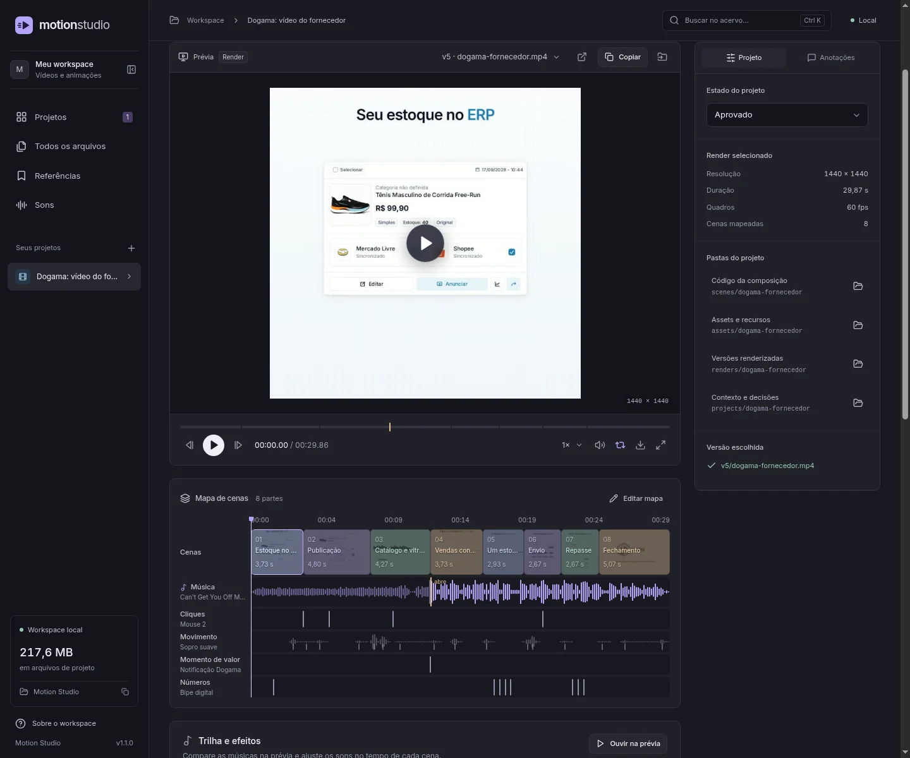
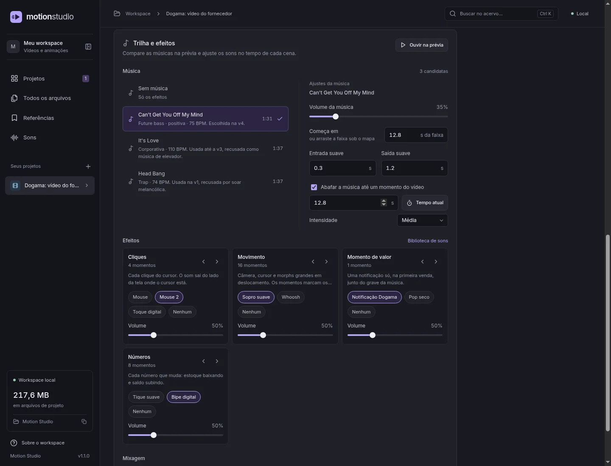
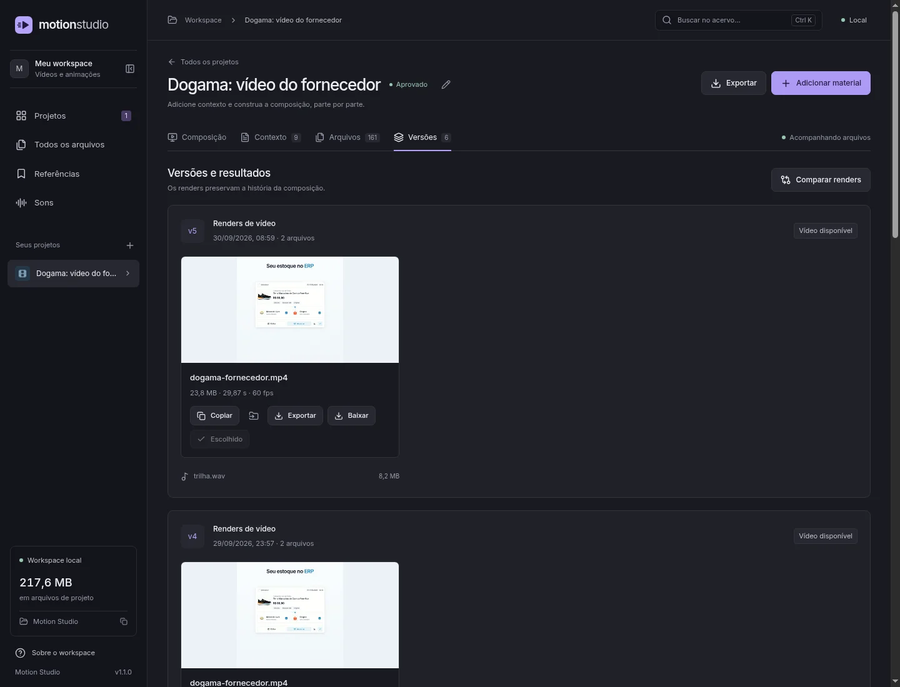

<div align="center">


# Motion Studio

**A local studio for videos made in code.**<br>
Preview the scene. Find the sound. Review the next version.


[Run locally](#run-locally) · [Project files](#project-files) · [Under the hood](#under-the-hood)

<br>



<sub>A real Dogama video project. Screenshots show the interface in Portuguese.</sub>

</div>

## From the scene to the final cut

I built Motion Studio to keep the videos I make for Dogama together: the composition, sound choices, review notes and rendered versions.

- **Preview code and video together.** Switch between the live HTML composition, rendered videos and scene alternatives.
- **See the timing.** Map scenes beside the music waveform and sound effect cues, then jump to the moment you want to review.
- **Choose audio in context.** Compare music candidates and effect options while watching the composition.
- **Leave a note at the right moment.** Attach feedback to a timestamp and file, then resolve it as the work progresses.
- **Keep the history.** Compare renders, choose the approved version and export a smaller copy for sharing.

## Find the sound in context

Audition music and effects against the same preview. Adjust the music offset, volume, fades and opening filter; choose each effect layer independently.

<p align="center">
  
</p>

Audio choices stay in the project manifest, ready for the next mix and render.

## Review the next version

Keep each render under a new version folder. The Studio discovers the files, groups the results and lets you compare two videos with synchronized playback.

<p align="center">
  
</p>

The chosen render, timestamped notes and resolved feedback stay with the project.

## Run locally

Requires [Bun](https://bun.sh), [FFmpeg and ffprobe](https://ffmpeg.org/download.html). Run these commands from a terminal:

```bash
git clone https://github.com/pedrinhopagan/motion-studio.git
cd motion-studio
bun run setup
bun run build
bun run start
```

Open [localhost:4318](http://localhost:4318). The app reads and writes project files inside the cloned repository.

For development, run `bun run dev` and open [localhost:4317](http://localhost:4317). The API uses port `4318`; composition previews use `4319`.

<details>
<summary>Rendering tools</summary>

The Studio previews compositions and reviews results. The scripts in `tools/` render the scene code into files:

| Tool | Purpose |
| --- | --- |
| [render.ts](tools/render.ts) | Render an MP4 or a sequence of frames, with an optional audio track |
| [still.ts](tools/still.ts) | Capture named stills at specific timestamps |

These scripts currently target Linux with GPU rendering. They expect a Playwright Chromium headless shell under `~/.cache/ms-playwright`; MP4 encoding uses FFmpeg VAAPI at `/dev/dri/renderD128`.

Command arguments are documented at the top of each script. Store each result in a new `renders/<project>/vN/` folder to keep earlier versions available.

</details>

## Project files

Each project keeps its source, materials and decisions on disk:

| Path | What lives there |
| --- | --- |
| `projects/<project>/motion.json` | Scene map, audio choices, review notes and approval state |
| `projects/<project>/context/` | Briefs and supporting documents |
| `scenes/<project>/` | HTML and JavaScript composition source |
| `assets/<project>/` | Images, fonts, music and sound effects |
| `renders/<project>/vN/` | Rendered videos and version materials |

Create a project in the Studio to generate the manifest and a starter composition. Edit the scene code with your editor or coding agent; review it in the Studio.

## Under the hood

| Layer | Built with |
| --- | --- |
| Interface | React, TypeScript, Vite and TanStack Query |
| Local API | Bun, bound to loopback |
| Project format | JSON manifests validated with Zod, plus files on disk |
| Live preview | HTML compositions, Canvas 2D, WebGL and Web Audio |
| Media tools | FFmpeg, ffprobe and Playwright Chromium |

<div align="center">
<sub>Built by <a href="https://www.devpedropagan.com.br/">Pedro Pagan</a> · <a href="https://www.devpedropagan.com.br/motion-studio">Project story</a></sub>
</div>
